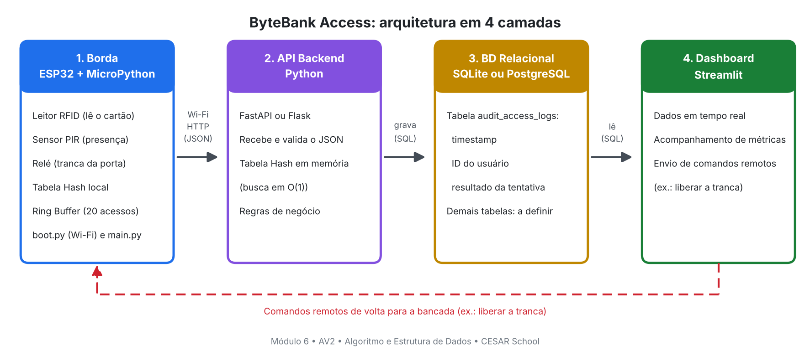
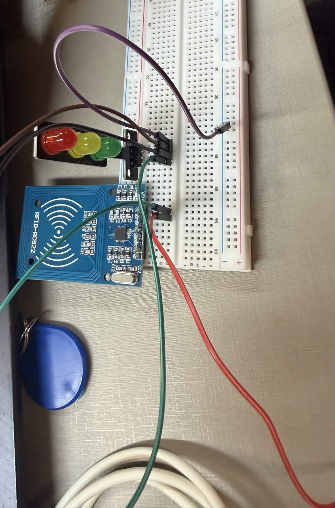

# ByteBank Access

Controle de acesso à área VIP e ao cofre do ByteBank, com ESP32 e MicroPython.
Este é o Módulo 6 do projeto da AV2 de Algoritmo e Estrutura de Dados (CESAR School, Tecnólogo em Banco de Dados e Inteligência Artificial). Professor: Fernando Ferreira de Carvalho.

## Equipe

- Thiago Alves
- José Bruno

## O que o módulo vai fazer

Uma pessoa encosta o cartão no leitor RFID. O ESP32 procura o cartão em uma Tabela Hash guardada na própria memória e descobre quem é e qual a categoria. Uma luz mostra o resultado e o acesso é liberado:

| Categoria | Luz | Acesso |
| --- | --- | --- |
| VIP | Amarela | Liberado |
| Estágio | Verde | Liberado |
| Visita | Vermelha | Liberado |
| Cartão não cadastrado | As 3 piscam | Negado |

O sensor de presença (PIR) serve para saber se tem alguém perto da porta. Ele entra no registro de cada acesso.

Os últimos 20 acessos ficam guardados na placa em um Ring Buffer (fila circular). Cada tentativa de acesso também é enviada pela rede para a API em Python, que grava no banco de dados, na tabela `audit_access_logs`, com data e hora, ID do usuário e resultado da tentativa. Um dashboard em Streamlit mostra esses dados e envia comandos de volta para a placa.

## Arquitetura



| Camada | O que faz | Estruturas de dados |
| --- | --- | --- |
| Borda (ESP32 + MicroPython) | Lê o RFID e o PIR, acende a luz da categoria, conecta no Wi-Fi e envia os dados | Tabela Hash local e Ring Buffer de 20 acessos |
| API Backend (Python) | Recebe o JSON, valida e aplica as regras de negócio | Tabela Hash em memória, busca em O(1) |
| BD Relacional | Guarda o histórico de acessos | Tabela `audit_access_logs` |
| Dashboard (Streamlit) | Mostra os dados em tempo real e envia comandos para a placa | - |

## Hardware

- ESP32 com MicroPython
- Leitor RFID RC522 com cartão e chaveiro (tag)
- Sensor de presença PIR
- Módulo semáforo com 3 LEDs (amarelo, verde e vermelho)
- Protoboard e jumpers

### Pinos

O RC522 liga só no 3V3. Se o módulo semáforo não tiver resistor, use um de 220 ohms em cada LED.

| Componente | Sinal | Pino do ESP32 |
| --- | --- | --- |
| RFID RC522 | SDA (SS) | GPIO 5 |
| RFID RC522 | SCK | GPIO 18 |
| RFID RC522 | MOSI | GPIO 23 |
| RFID RC522 | MISO | GPIO 19 |
| RFID RC522 | RST | GPIO 22 |
| Sensor PIR | OUT | GPIO 33 |
| LED amarelo (VIP) | Ânodo | GPIO 26 |
| LED verde (Estágio) | Ânodo | GPIO 25 |
| LED vermelho (Visita) | Ânodo | GPIO 27 |

## Estrutura do repositório

```
esp32/
  boot.py                  conecta o ESP32 ao Wi-Fi
  main.py                  lê o cartão e o PIR, acende a luz e envia o JSON
  estruturas.py            Tabela Hash dos cartões e Ring Buffer dos acessos
  mfrc522.py               biblioteca do leitor RC522 (ver Créditos)
  LICENSE_mfrc522.txt      licença da biblioteca
  config_wifi.example.py   modelo para o arquivo com a senha do Wi-Fi
docs/
  arquitetura.png          diagrama de arquitetura
tests/
  test_boot.py             testes do boot.py rodando no computador
  test_estruturas.py       testes da Tabela Hash e do Ring Buffer
  test_main.py             testes do fluxo do main.py
```

A API, o `schema.sql` e o dashboard entram nas próximas entregas.

## Entrega 2: como o main.py funciona

1. Liga o leitor RC522 e os 3 LEDs.
2. Fica lendo o cartão a cada 100 ms. O sensor PIR avisa quando tem alguém por perto.
3. Com o cartão lido, procura o UID na Tabela Hash (`cartoes`). A busca é O(1).
4. Se achou, acende a luz da categoria por 3 segundos. Se não achou, as 3 luzes piscam.
5. Guarda o acesso no Ring Buffer (os 20 últimos ficam na memória da placa).
6. Envia um JSON com `urequests.post()` para `http://httpbin.org/post`, um servidor de teste que devolve o que recebe. Quando dá certo, o terminal mostra `Servidor respondeu: 200`.

Exemplo do JSON enviado:

```
{"uid": "01020304", "nome": "Pessoa VIP", "categoria": "vip",
 "resultado": "liberado", "presenca": false, "uptime_ms": 12345}
```

Os nomes e UIDs que aparecem no código são de teste. Para cadastrar um cartão seu, rode o `main.py`, encoste o cartão e copie o UID que aparece em "Cartão não cadastrado". Depois coloque esse UID em uma linha `cartoes.cadastrar(...)` do `main.py`.

O servidor de teste usa HTTP sem criptografia. Por isso só vão dados de teste, nada de dado real de pessoa.

## Como rodar na placa

1. Instale o firmware do MicroPython no ESP32 (baixe a versão para ESP32 em micropython.org/download).
2. Copie `esp32/config_wifi.example.py` com o nome `config_wifi.py` e preencha o nome e a senha da sua rede. O ESP32 só conecta em rede de 2,4 GHz.
3. Envie para a placa `boot.py`, `config_wifi.py`, `main.py`, `estruturas.py` e `mfrc522.py`. No Thonny, abra cada arquivo e use "Salvar como" e depois "Dispositivo MicroPython".
4. Reinicie a placa. A saída aparece no terminal do Thonny. Quando dá certo, aparece algo assim:

```
Conectando à rede 'NomeDaRede' (tentativa 1 de 3)...
Wi-Fi conectado! IP: 192.168.0.50
ByteBank Access pronto. Aproxime um cartão.
Acesso liberado: Pessoa VIP | categoria: vip
Servidor respondeu: 200
Ring Buffer: 1 de 20 acessos guardados
```

O `config_wifi.py` está no `.gitignore`. A senha do Wi-Fi não vai para o GitHub.

Se não conectar depois de 3 tentativas, o `boot.py` avisa no terminal e deixa a placa ligada, para o `main.py` poder guardar os acessos na fila local.

## Testes

Os testes rodam no computador com Python 3 e usam módulos de mentira (`machine`, `network`, `urequests` e o leitor) para simular a placa. Cobrem o `boot.py` (conexão, senha errada, falha do rádio, senha nunca aparece na saída), a Tabela Hash, o Ring Buffer (inclusive quando enche e sobrescreve o mais antigo) e o fluxo do `main.py` (cartão liberado, não cadastrado, falha de rede e repetição do mesmo cartão).

```
python -m unittest discover tests -v
```

Esses testes conferem a lógica do código. Eles não substituem o teste na placa de verdade.

## Teste no simulador

Antes da bancada, o circuito e o código foram rodados no simulador Wokwi (ESP32 com MicroPython, Wi-Fi `Wokwi-GUEST`). O cartão foi lido, a categoria identificada e o servidor respondeu 200. No simulador os UIDs são os dos cartões de teste do Wokwi (`01020304`, `11223344` e `55667788`). Na bancada, troque pelos UIDs dos nossos cartões.

## Circuito na bancada



Foto de 05/11, durante a montagem: ESP32, leitor RC522, módulo semáforo (amarelo, verde e vermelho) e a tag azul.

Situação nesse momento: a placa roda o `main.py` e mostra "Aproxime um cartão" no terminal. O leitor ainda não respondeu na bancada (a leitura do registrador de versão do chip volta 0x0). Estamos conferindo a ligação dos fios. O fluxo completo (cartão, categoria, luz e envio do JSON) já foi validado no simulador.

## Créditos

A leitura do RC522 usa a biblioteca `micropython-mfrc522` de Stefan Wendler (licença MIT, em `esp32/LICENSE_mfrc522.txt`). Fizemos três ajustes: suporte à placa ESP32, a condição de espera do `_tocard` (a original usava `~` em booleanos e saía do laço cedo demais) e a leitura da FIFO em uma transação só.

## Andamento

- [ ] Entrega 1 (29/10): repositório, README, diagrama e `boot.py` prontos. Falta registrar o teste do `boot.py` na placa.
- [ ] Entrega 2 (05/11): `main.py`, estruturas em memória e envio de JSON prontos e testados no simulador. Falta a foto do circuito na bancada.
- [ ] Entrega 3 (12/11): API em Python, `schema.sql` e banco de dados
- [ ] Entrega 4 (19/11): dashboard em Streamlit e teste de ponta a ponta
- [ ] Entrega final (26/11): demonstração na bancada

## Ainda a definir pelo grupo

- FastAPI ou Flask
- SQLite ou PostgreSQL
- Papel exato do sensor PIR no fluxo de acesso
