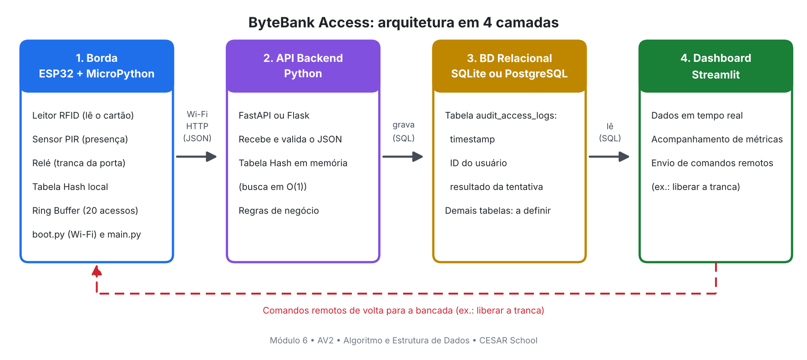

# ByteBank Access

Controle de acesso à área VIP e ao cofre do ByteBank, com ESP32 e MicroPython.
Este é o Módulo 6 do projeto da AV2 de Algoritmo e Estrutura de Dados (CESAR School, Tecnólogo em Banco de Dados e Inteligência Artificial). Professor: Fernando Ferreira de Carvalho.

## Equipe

- Thiago Alves
- José Bruno

## O que o módulo vai fazer

Uma pessoa encosta o cartão no leitor RFID. O ESP32 procura o cartão em uma Tabela Hash guardada na própria memória. Se o cartão é válido, o relé abre a tranca da porta. O sensor de presença (PIR) serve para saber se tem alguém perto da porta.

Os últimos 20 acessos ficam guardados na placa em um Ring Buffer (fila circular). Cada tentativa de acesso também é enviada pela rede para a API em Python, que grava no banco de dados, na tabela `audit_access_logs`, com data e hora, ID do usuário e resultado da tentativa. Um dashboard em Streamlit mostra esses dados e envia comandos de volta para a placa.

## Arquitetura



| Camada | O que faz | Estruturas de dados |
| --- | --- | --- |
| Borda (ESP32 + MicroPython) | Lê o RFID e o PIR, aciona o relé, conecta no Wi-Fi e envia os dados | Tabela Hash local e Ring Buffer de 20 acessos |
| API Backend (Python) | Recebe o JSON, valida e aplica as regras de negócio | Tabela Hash em memória, busca em O(1) |
| BD Relacional | Guarda o histórico de acessos | Tabela `audit_access_logs` |
| Dashboard (Streamlit) | Mostra os dados em tempo real e envia comandos para a placa | - |

## Hardware

- ESP32 com MicroPython
- Leitor RFID (modelo RC522, igual ao da especificação do Módulo 1; falta confirmar com o que temos na bancada)
- Sensor de presença PIR
- Módulo relé para a tranca da porta

### Pinos

Proposta inicial. Ainda não foi testada na bancada e pode mudar na Entrega 2.

| Componente | Sinal | Pino do ESP32 |
| --- | --- | --- |
| RFID RC522 | SDA (SS) | GPIO 5 |
| RFID RC522 | SCK | GPIO 18 |
| RFID RC522 | MOSI | GPIO 23 |
| RFID RC522 | MISO | GPIO 19 |
| RFID RC522 | RST | GPIO 22 |
| Sensor PIR | OUT | GPIO 27 |
| Módulo relé | IN | GPIO 26 |

## Estrutura do repositório

```
esp32/
  boot.py                  conecta o ESP32 ao Wi-Fi
  config_wifi.example.py   modelo para o arquivo com a senha do Wi-Fi
docs/
  arquitetura.png          diagrama de arquitetura
tests/
  test_boot.py             testes do boot.py rodando no computador
```

Os arquivos `main.py`, da API, do `schema.sql` e do dashboard entram nas próximas entregas.

## Como rodar o boot.py

1. Instale o firmware do MicroPython no ESP32 (baixe a versão para ESP32 em micropython.org/download).
2. Copie `esp32/config_wifi.example.py` com o nome `config_wifi.py` e preencha o nome e a senha da sua rede. O ESP32 só conecta em rede de 2,4 GHz.
3. Envie `boot.py` e `config_wifi.py` para a placa. No Thonny, abra cada arquivo e use "Salvar como" e depois "Dispositivo MicroPython".
4. Reinicie a placa. A saída aparece no terminal do Thonny. Quando dá certo, aparece algo assim:

```
Conectando à rede 'NomeDaRede' (tentativa 1 de 3)...
Wi-Fi conectado! IP: 192.168.0.50
```

O `config_wifi.py` está no `.gitignore`. A senha do Wi-Fi não vai para o GitHub.

Se não conectar depois de 3 tentativas, o `boot.py` avisa no terminal e deixa a placa ligada, para o `main.py` poder guardar os acessos na fila local.

## Testes

O `boot.py` tem testes que rodam no computador com Python 3. Eles usam um módulo `network` de mentira para simular a placa. Cobrem conexão com sucesso, rede já conectada, senha errada, falha do rádio, arquivo de senha ausente e a garantia de que a senha nunca aparece na saída.

```
python -m unittest discover tests -v
```

Esses testes conferem a lógica do código. Eles não substituem o teste na placa de verdade.

## Andamento

- [ ] Entrega 1 (29/10): repositório, README, diagrama e `boot.py` prontos. Falta registrar o teste do `boot.py` na placa.
- [ ] Entrega 2 (05/11): `main.py` com sensores, estruturas em memória e envio de JSON
- [ ] Entrega 3 (12/11): API em Python, `schema.sql` e banco de dados
- [ ] Entrega 4 (19/11): dashboard em Streamlit e teste de ponta a ponta
- [ ] Entrega final (26/11): demonstração na bancada

## Ainda a definir pelo grupo

- FastAPI ou Flask
- SQLite ou PostgreSQL
- Modelo exato do leitor RFID
- Pinos definitivos
- Papel exato do sensor PIR no fluxo de acesso
