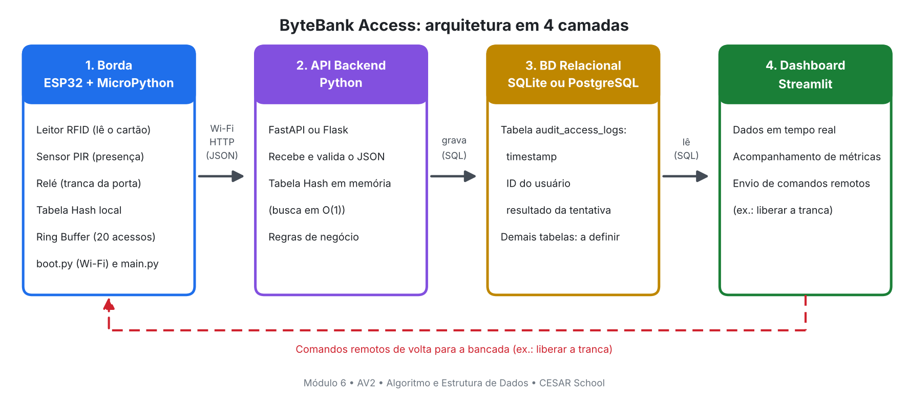
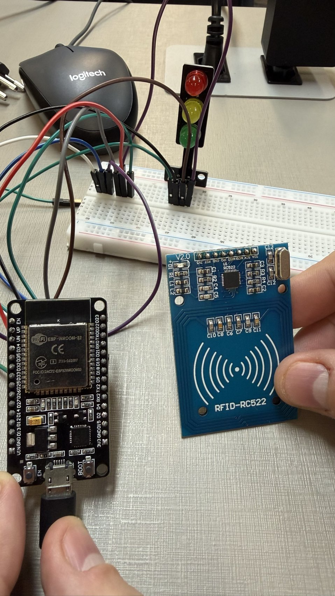
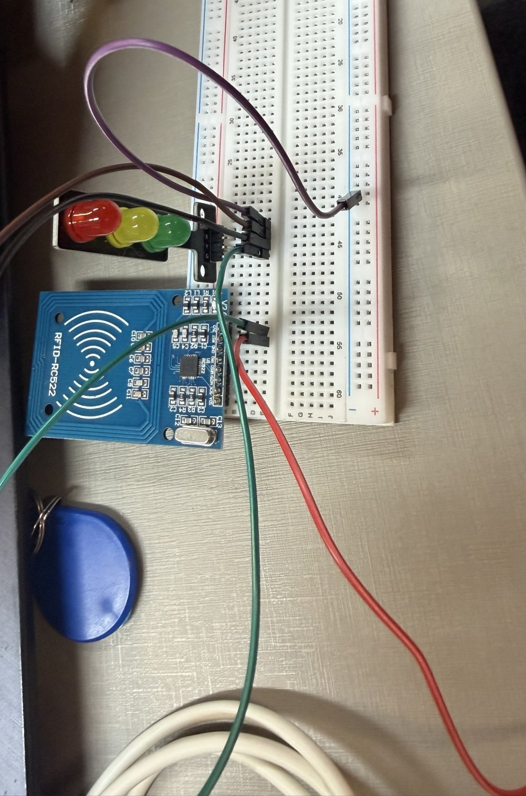

# ByteBank Access

Controle de acesso à área VIP e ao cofre do ByteBank, com ESP32 e MicroPython.
Este é o Módulo 6 do projeto da AV2 de Algoritmo e Estrutura de Dados (CESAR School, Tecnólogo em Banco de Dados e Inteligência Artificial). Professor: Fernando Ferreira de Carvalho.

## Equipe

- Thiago Alves
- José Bruno
- Gibson Rocha

## O que o projeto faz

Uma pessoa encosta o cartão no leitor RFID. O ESP32 manda o UID do cartão para a API. A API procura o cartão em uma Tabela Hash, decide se libera e grava a tentativa no banco. O dashboard mostra a luz da categoria em um semáforo na tela:

| Categoria | Luz | Acesso |
| --- | --- | --- |
| VIP | Amarela | Liberado |
| Estágio | Verde | Liberado |
| Visita | Vermelha | Liberado |
| Cartão não cadastrado | As 3 acendem | Negado |

Na bancada ficam só o ESP32 e o leitor RFID. O semáforo de LEDs e o sensor de presença (PIR) saíram da montagem para diminuir o trabalho físico: a luz de cada acesso aparece no dashboard. O código da placa ainda aciona os pinos dos LEDs e lê o pino do PIR. Sem eles ligados o fluxo é o mesmo, e todo acesso vai com `presenca: false`.

O dashboard em Streamlit mostra o semáforo e os acessos em tempo real e manda comandos para a placa. "Liberar trava" acende a luz verde na tela e "acionar alarme" acende as 3.

### Painel na nuvem

O painel também está publicado em https://bytebank-access.streamlit.app, em modo demonstração: na nuvem não tem a API em outro processo nem a placa, então a API roda dentro do painel e uma placa simulada (botões "Cartão VIP", "Cartão sem cadastro" etc.) faz o papel do ESP32. O arquivo de entrada é `dashboard/painel_nuvem.py`. Esse painel não enxerga o hardware da bancada.

## Arquitetura



| Camada | Arquivo | O que faz | Estrutura de dados |
| --- | --- | --- | --- |
| Borda | `esp32/main.py` | Lê o cartão e o PIR, acende a luz, envia o JSON e busca comandos | Ring Buffer (20 últimos acessos) e Tabela Hash local (cartões já liberados, para quando a rede cair) |
| API | `api/app.py` | Recebe o JSON, valida, decide o acesso e grava no banco | Tabela Hash em memória, busca O(1) |
| Banco | `api/schema.sql` | Guarda usuários, logs de auditoria, saldos e transações | Tabela `audit_access_logs` |
| Dashboard | `dashboard/painel.py` | Mostra os acessos e envia comandos | - |

Caminho de um acesso:

```
cartão -> ESP32 --POST /acessos--> API (Tabela Hash) --> banco (audit_access_logs)
                                                           |
                                         dashboard <-------+  (lê a cada 2 s)
dashboard --POST /comandos--> API --GET /comandos/proximo--> ESP32 (a cada 2 s)
```

## Hardware

- ESP32 DevKit (ESP-WROOM-32) com MicroPython
- Leitor RFID RC522 com cartão e chaveiro (tag)
- Sensor de presença PIR
- Módulo semáforo com 3 LEDs (pinos R, Y, G e GND)
- Protoboard e jumpers

### Ligações

Os nomes são os que estão impressos nas placas. Na montagem atual só o RC522 fica ligado; as linhas do semáforo e do PIR são opcionais.

| De | Para (ESP32) |
| --- | --- |
| RC522 SDA | D5 |
| RC522 SCK | D18 |
| RC522 MOSI | D23 |
| RC522 MISO | D19 |
| RC522 IRQ | não liga |
| RC522 GND | GND |
| RC522 RST | D22 |
| RC522 3V3 | 3V3 |
| Semáforo R (vermelho, visita) | D27 |
| Semáforo Y (amarelo, VIP) | D26 |
| Semáforo G (verde, estágio) | D25 |
| Semáforo GND | GND |
| PIR VCC | VIN (5 V) |
| PIR OUT | D33 |
| PIR GND | GND |

O RC522 só aguenta 3,3 V. Nunca ligue ele no VIN.

O PIR é opcional para rodar. Sem ele, o pino D33 fica em 0 e todo acesso vai com `presenca: false`.



## Estrutura do repositório

```
esp32/
  boot.py                  conecta o ESP32 ao Wi-Fi
  main.py                  lê o cartão, fala com a API, acende a luz e executa comandos
  estruturas.py            Tabela Hash e Ring Buffer
  mfrc522.py               biblioteca do leitor RC522 (ver Créditos)
  LICENSE_mfrc522.txt      licença da biblioteca
  config_wifi.example.py   modelo para o arquivo com a senha do Wi-Fi
api/
  app.py                   API em Flask
  schema.sql               tabelas do banco
  requirements.txt
dashboard/
  painel.py                dashboard em Streamlit
  requirements.txt
docs/                      diagrama e fotos
tests/                     testes (rodam no computador)
```

## Como rodar tudo

Precisa de Python 3 no computador. A placa e o computador ficam na mesma rede Wi-Fi (2,4 GHz).

**1. API** (terminal 1)

```
cd api
pip install -r requirements.txt
python app.py
```

Na primeira vez ela cria o banco `api/bytebank.db`, cadastra três cartões de exemplo e carrega a Tabela Hash.

**2. Dashboard** (terminal 2)

```
cd dashboard
pip install -r requirements.txt
streamlit run painel.py
```

Abre no navegador em `http://localhost:8501`.

**Monitor de bancada pela USB**

Para acompanhar o leitor real sem configurar Wi-Fi, execute na raiz do projeto:

```sh
.venv/bin/python dashboard/monitor_nfc.py
```

Abra `http://127.0.0.1:8502`. O monitor mostra a conexão, as tentativas de leitura,
as tags detectadas e as mensagens reais do ESP32, atualizadas a cada segundo.
O leitor aceita UIDs de 4, 7 e 10 bytes. Uma chave mantida sobre a antena é
contada uma vez; afaste por cerca de dois segundos para registrar nova aproximação.
Se a placa reiniciar ou parar de enviar status, o monitor reabre a comunicação
automaticamente. Uma conexão USB ativa não significa que uma tag foi reconhecida:
confira o contador de detecções e o UID exibido.
O ESP32 precisa ter MicroPython e `mfrc522.py`. O script de monitoramento roda
na memória da placa; não substitui o `main.py`. Feche outros programas que
estejam usando a mesma porta USB antes de iniciar.

A placa desta bancada é selecionada pelo número de série `56AB001645`.
Para outra placa, informe `BYTEBANK_ESP32_PORT` com a porta serial ou
`BYTEBANK_ESP32_SERIAL` com seu número de série. As dependências do monitor
estão em `dashboard/requirements.txt`.

**3. Placa**

1. Descubra o IP do computador (`ipconfig` no Windows) e coloque em `URL_API` no `esp32/main.py`, por exemplo `http://192.168.0.10:5000`.
2. Copie `config_wifi.example.py` com o nome `config_wifi.py` e preencha nome e senha da rede. Esse arquivo não vai para o GitHub.
3. No Thonny, envie para a placa `boot.py`, `config_wifi.py`, `main.py`, `estruturas.py` e `mfrc522.py` ("Salvar como" e depois "Dispositivo MicroPython").
4. Aperte EN na placa. O terminal mostra:

```
Wi-Fi conectado! IP: 192.168.0.50
ByteBank Access pronto. Aproxime um cartão.
Servidor respondeu: 201
Acesso liberado | categoria: vip | decidido: api
Ring Buffer: 1 de 20 acessos guardados
```

### Cadastrar um cartão

Encoste o cartão. Se ele não estiver cadastrado, o terminal mostra `Acesso negado, UID: a1b2c3d4` e o dashboard mostra o pedido "Cartão novo: cadastrar". Escolha no painel o que o cartão será (VIP, Estágio ou Visita), escreva o nome se quiser e clique em "Cadastrar cartão". Na próxima vez o cartão entra com a luz da categoria escolhida.

Também dá para cadastrar direto na API:

```
curl -X POST http://localhost:5000/usuarios -H "Content-Type: application/json" -d "{\"uid\": \"a1b2c3d4\", \"nome\": \"Thiago\", \"categoria\": \"vip\"}"
```

Também dá para trocar os UIDs de exemplo em `USUARIOS_INICIAIS`, no `api/app.py`, antes de criar o banco. O cadastro fica só na API. A placa não precisa ser regravada.

## Estruturas de dados

**Tabela Hash (API).** Um `dict` do Python carregado da tabela `usuarios` quando a API sobe. A chave é o UID do cartão. A busca é O(1), então a decisão não espera consulta ao banco.

**Tabela Hash (placa).** Guarda os cartões que a API já liberou. Se o Wi-Fi ou a API caírem, a placa ainda reconhece esses cartões. Cartão nunca visto é negado.

**Ring Buffer (placa).** Fila circular com os 20 últimos acessos. Quando enche, o novo toma o lugar do mais antigo, e a memória da placa não cresce. O comando "resetar contador" do dashboard zera essa fila.

**Atualização atômica (API).** Em `POST /transacoes`, o `UPDATE` do saldo e o `INSERT` da transação ficam no mesmo bloco `with`, que é uma transação SQL. Se o saque deixar o saldo negativo, o `CHECK (saldo >= 0)` do `schema.sql` falha e o banco desfaz tudo.

## Rotas da API

| Rota | Quem usa | O que faz |
| --- | --- | --- |
| `POST /acessos` | ESP32 | Recebe `{"uid", "presenca"}`, decide e grava em `audit_access_logs` com timestamp, usuário e resultado |
| `GET /acessos` | Dashboard | Últimos acessos |
| `POST /comandos` | Dashboard | Coloca um comando na fila (`liberar`, `alarme` ou `resetar`) |
| `GET /comandos/proximo` | ESP32 | Entrega o comando mais antigo e tira da fila |
| `GET /usuarios`, `POST /usuarios` | Grupo | Lista e cadastra cartões |
| `POST /transacoes`, `GET /saldos/<uid>` | Grupo | Depósito, saque e saldo |

## Comandos do dashboard

| Botão | O que a placa faz |
| --- | --- |
| Liberar trava | Acende a luz verde por 3 s |
| Acionar alarme | Pisca as 3 luzes 6 vezes |
| Resetar contador | Zera o Ring Buffer |

A placa pergunta à API a cada 2 segundos se tem comando novo. Por isso o comando leva até 2 s para chegar.

## Testes

```
pip install flask streamlit pandas requests
python -m unittest discover tests -v
```

| Arquivo | O que confere |
| --- | --- |
| `test_boot.py` | Conexão Wi-Fi, senha errada, senha nunca aparece na saída |
| `test_estruturas.py` | Tabela Hash e Ring Buffer (cheio, sobrescreve o mais antigo, limpar) |
| `test_main.py` | Fluxo da placa com hardware simulado: luz certa por categoria, negado pisca, sem Wi-Fi usa a hash local, comandos |
| `test_mfrc522.py` | Inicialização SPI e reset, CRC, seleção de tags e UIDs completos de 4, 7 e 10 bytes |
| `test_monitor_nfc.py` | Telemetria USB, perda de atualizações e recuperação sem processos concorrentes na mesma serial |
| `test_api.py` | Rotas da API, saque sem saldo não grava nada, comando chega uma vez só |
| `test_painel_demo.py` | Painel em modo demonstração: placa simulada gera acessos, o semáforo da tela mostra a luz certa, um cartão novo é cadastrado pelo painel e o comando chega |
| `test_ponta_a_ponta.py` | Fluxo completo: sobe a API, faz o papel do ESP32, abre o dashboard, clica em "Liberar trava" e confere que o comando chega na placa. Também manda 30 acessos seguidos sem travar |

Os testes da placa usam módulos de mentira (`machine`, `network`, `urequests` e o leitor). Eles conferem a lógica, mas não substituem o teste na bancada.

## Teste no simulador

Antes da bancada, o circuito e o código foram rodados no Wokwi (ESP32 com MicroPython, Wi-Fi `Wokwi-GUEST`). O cartão foi lido, a categoria identificada e o servidor respondeu.

## Circuito na bancada



Foto de 05/11, durante a montagem. Nessa data o leitor ainda não respondia na bancada (registrador de versão do chip voltava 0x0). Refizemos as ligações conforme a tabela acima.

## Créditos

A leitura do RC522 usa a biblioteca `micropython-mfrc522` de Stefan Wendler (licença MIT, em `esp32/LICENSE_mfrc522.txt`). Fizemos três ajustes: suporte à placa ESP32, a condição de espera do `_tocard` (a original usava `~` em booleanos e saía do laço cedo demais) e a leitura da FIFO em uma transação só.

## Andamento

- [x] Entrega 1 (29/10): repositório, README, diagrama e `boot.py`
- [x] Entrega 2 (05/11): `main.py`, estruturas em memória e envio de JSON, foto da bancada
- [x] Entrega 3 (12/11): API em Flask, `schema.sql` e banco SQLite
- [x] Entrega 4 (19/11): dashboard em Streamlit, comandos para a placa e teste de ponta a ponta
- [ ] Entrega final (26/11): demonstração na bancada
